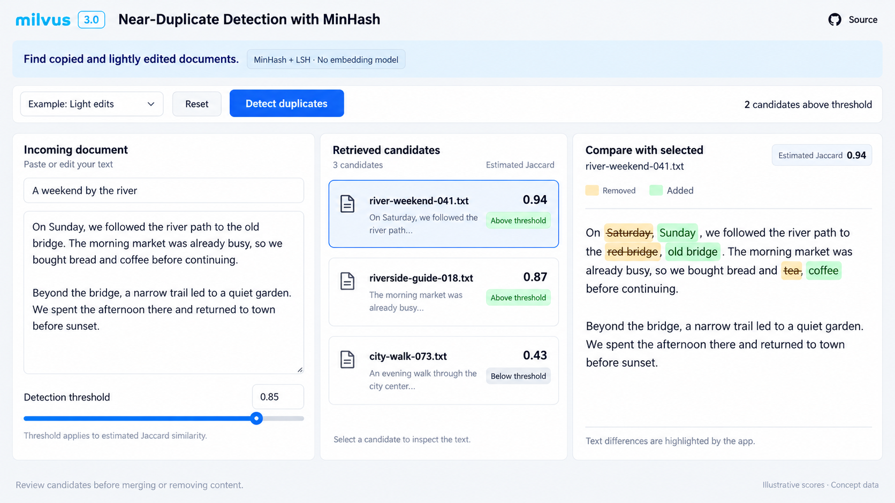

# 文本近重复检测：MinHash + LSH

状态：明确实施方向为 MinHash Function + MINHASH_LSH；当前页面为概念草图，尚未实现。

## 用户场景与范围

用户粘贴一段文章，或者选择一个预设样例，在已有文档集合中查找完全复制或轻微修改的文本，并通过差异对照判断候选是否属于近重复内容。

这一版使用文本片段重合意义上的相似度，不调用 Embedding 模型。Embedding + ANN、Range Search、K-means 和 SemDeDup 均为尚未决定是否实施的后续方向，不出现在本轮页面的功能或模式切换中。

MinHash 的随机排序类比可以用于文章和视频开场。在线页面不展示随机排列、指纹数组、LSH 分桶动画、复杂度公式或算法推导。

## 页面与交互草案

| 区域 | 设计 |
| --- | --- |
| 顶栏 | Milvus 3.0 标识、`Near-Duplicate Detection with MinHash` 标题和 Source 链接 |
| 简短说明 | `Find copied and lightly edited documents.`，标明 `MinHash + LSH` |
| 操作栏 | 预设案例下拉框、Reset、Detect duplicates 和超过阈值的已返回候选数量 |
| 左栏 | `Incoming document`：标题与正文编辑区，以及检测阈值控件 |
| 中栏 | `Retrieved candidates`：候选文档、摘要、估计 Jaccard 相似度与阈值状态 |
| 右栏 | `Compare with selected`：选中文档的文本差异，以删除和新增标记突出变化 |

点击候选时更新右栏差异对照。阈值用于区分当前检索候选中的达标项，不应表述为“全库已有多少篇重复文章”。第一版以检查和解释结果为主，不提供自动删除或自动合并。

草图中的阈值为 `0.85`，三个估计相似度为 `0.94`、`0.87`、`0.43`，因此有两个已返回候选超过阈值。这些数值只表达界面状态，尚未从图中的文本运行得到，也不是建议采用的通用阈值。

## 数据与 Milvus 路径

采用可公开分发的原创短文及其受控变体，避免引入来源不明的文章或用户隐私。建议覆盖原文复制、少量词句修改、增删段落、同主题不同内容和无关内容。最终数据量、长度和预设案例尚未确定。

集合包含稳定文档主键、标题、原始 `VARCHAR` 文本和用于 MinHash 输出的 `BINARY_VECTOR` 字段。由 Schema 中的 `FunctionType.MINHASH` 在写入和文本查询时执行一致的文本处理与签名生成，再通过 `MINHASH_LSH` 索引召回候选。

实现时需核实并遵守：

- MinHash 签名维度为 `32 * num_hashes`；使用内置函数的输出时，索引的 `mh_element_bit_width` 为 `32`。
- 使用 `MHJACCARD` 度量。展示值明确标为 `Estimated Jaccard`，并验证 API 返回的距离与展示相似度之间的转换，不能把距离直接误标为相似度。
- 开启 Jaccard refinement 后，根据原始 MinHash 签名估计相似度并排序；这不等于重新比较全文片段集合得到精确 Jaccard。
- 分词方式、`shingle_size`、`num_hashes`、分桶参数和候选预算在实现阶段通过样例验证后确定。
- LSH 可能漏召回，候选预算也可能截断结果。未检出达标候选不构成“绝对不存在近重复”的证明。

原始全文之间的差异高亮由应用侧计算，它是阅读辅助，不是 Milvus 返回的匹配片段解释。正文比对时必须明确哪个是已有文档、哪个是待检查文本，并保持新增和删除颜色的语义一致。

## 分数与阈值的展示规则

相似度表示文本片段集合重合程度的估计，不能写成“重复概率”或“模型置信度”。页面可以保留少量低于阈值的已检索候选作为对照，但应明确标记 `Below threshold`，并让顶部达标数量与当前候选列表一致。

相似度高不必然意味着内容可以删除；涉及数字、时间、否定词等变化时仍需人工判断。主按钮为检测，结果为待审阅候选。

## 实现前待确认

需要固定原创数据与变体生成方式，验证典型查询的召回情况，选择合理的阈值范围，并确认编辑正文后如何触发重新检测。加载中、无候选、低于阈值、检索失败和输入过长等状态也需要补齐。

如后续决定增加语义去重，应作为单独确认的扩展设计，不默认为当前 Demo 的实现要求。

## 参考

- [Milvus MinHash Function](https://milvus.io/docs/minhash-function.md)
- [Milvus MINHASH_LSH](https://milvus.io/docs/minhash-lsh.md)
- [本轮设计总览](README.md)
